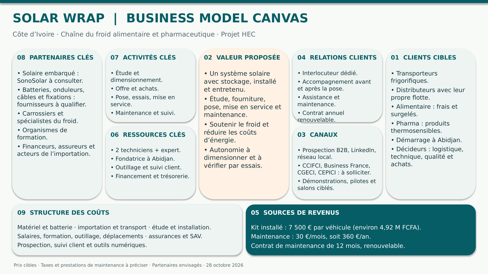

# Business Model Canvas — SOLAR WRAP

**Groupe 8 · Côte d’Ivoire · Version 1 · 28 octobre 2026 · Proposition à valider par l’équipe**

## Documents

- [PDF — une page](BUSINESS-MODEL-CANVAS.pdf)
- [PowerPoint modifiable — une slide](BUSINESS-MODEL-CANVAS.pptx)
- [Version texte détaillée, hypothèses et sources](BUSINESS-MODEL-CANVAS.md)
- [Image du canvas](BUSINESS-MODEL-CANVAS.png)

## Hypothèses commerciales retenues

- Kit installé : **7 500 € par véhicule**, étude, fourniture avec stockage, installation et mise en service.
- Maintenance : **30 €/mois**, soit **360 €/an**, contrat de douze mois renouvelable.
- Deux techniciens et un appui expert constituent l’équipe technique envisagée.

Les taxes, le coût complet, la marge et le périmètre de la maintenance restent à préciser. Les organismes et fournisseurs cités sont des pistes ; aucun partenariat n’est annoncé comme obtenu. Les autonomies et économies doivent être vérifiées par des essais.

Cette version reprend les dernières hypothèses communiquées pour le canvas. Elle ne modifie pas automatiquement les anciens chiffres du business plan ou du plan commercial.
