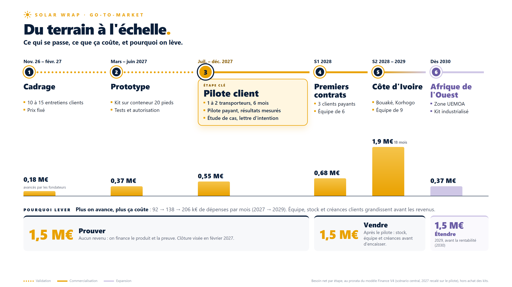

# Livrable Ventes — slide go-to-market

**Responsable :** Nabil (pôle Ventes) · **Version :** v1 — 29/10/2026 · **Statut :** proposition à valider

Slide de pitch « Du terrain à l'échelle » : les 6 étapes du go-to-market, les tâches de chaque étape, le besoin net par étape et les trois levées de 1,5 M€ (Prouver, Vendre, Étendre).

| Format | Fichier |
|---|---|
| Image 16:9 (3840 × 2160) | [SLIDE-PITCH-GO-TO-MARKET-COUTS-LEVEES-16x9.png](SLIDE-PITCH-GO-TO-MARKET-COUTS-LEVEES-16x9.png) |
| PowerPoint 16:9, avec notes de l'orateur | [SLIDE-PITCH-GO-TO-MARKET-COUTS-LEVEES.pptx](SLIDE-PITCH-GO-TO-MARKET-COUTS-LEVEES.pptx) |

**Source des chiffres :** modèle Finance V4 (2 FINANCE), scénario central, réparti au prorata des étapes, 2027 recalé sur le pilote, hors achat des kits.

**Point ouvert :** la Finance V4 prévoit 15 kits vendus en 2027, la feuille de route un seul pilote. À trancher avec la Finance.

Détail du plan : [4 VENTES/PLAN-COMMERCIAL.md](../../4%20VENTES/PLAN-COMMERCIAL.md)
