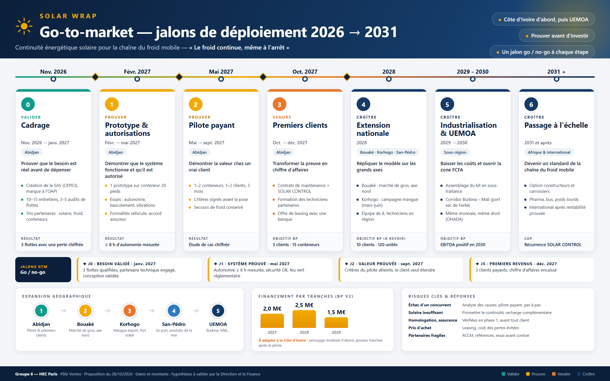

# 📈 Plan commercial SOLAR WRAP — Pôle Ventes

**Responsable : NAB** · **Version :** v1.5 — 28/10/2026 (v1.4 + jalons du go-to-market, section 18) · **Statut :** proposition, à valider par FAOUZI (Direction)

> Livrable attendu (cf. [tache et livrable de chacun](../tache%20et%20livrable%20de%20chacun.md)) : **plan commercial et premiers prospects**.
> Sources internes : [LA VISION DU CEO](../04-strategie/LA%20VISION%20DU%20CEO.MD), [étude de marché Marketing](../3%20MARKETING/SOLAR_WRAP_Etude_de_marche_synthetique_et_positionnement.md), [fiche Produit](../5%20PRODUIT/INSTALLATION%20PHOTOVOLTA%C3%8FQUE%20SUR%20CONTENEUR%20LOGISTIQUE%20FRIGORIFIQUE.md), [note Juridique / RH](../7%20JURIDIQUE%20RH/README.md), [business plan V2](../2%20FINANCE/SOLAR_WRAP_BP_V2.md), `02-banque-idees/CONTRADICTIONS ET INCOHERENCES.docx`.
> Les prix, autonomies et volumes ci-dessous sont des **hypothèses** ; rien n'est encore prouvé sur le terrain.

**Changements par rapport à la v1.1 :** alignement sur le positionnement « continuité d'alimentation » retenu par l'équipe ; gamme conteneurs 10 / 20 / 30 pieds de la fiche Produit ; segments repris de l'étude Marketing ; retrait de l'argument « mensualité < économies de gazole » ; ajout des promesses interdites avant preuve, des critères de qualification technique et des conditions du pilote demandées par le pôle Juridique / RH.

---

## 1. Points à arbitrer avec la Direction

| # | Sujet | État au 28/10 | Proposition Ventes |
|---|---|---|---|
| 1 | Pays de démarrage | Côte d'Ivoire retenue par le CEO, le Marketing et le Juridique ; le **business plan V2 reste construit sur Europe → Australie / Chili** | Faire adapter le business plan à la Côte d'Ivoire (LEVON) |
| 2 | Type d'équipement | **Réglé** : conteneurs frigorifiques de 10, 20 et 30 pieds montés sur camion ou remorque | — |
| 3 | Prix de vente | Ouvert : la fiche Produit donne des **coûts estimés**, pas des prix ; TVA indiquée à 20 % alors que le taux de droit commun ivoirien est de 18 % | Prix de vente en FCFA, marge comprise, TVA et frais d'importation vérifiés (LEVON) |
| 4 | Porteur du pilote client | Ouvert : le business plan attribue la flotte pilote à LEVON ; la note Juridique demande à NAB le client visé et les conditions de l'essai | Pilote porté par Ventes (NAB), avec Produit (ILYES) pour la technique |
| 5 | **Prix du kit — 🔴 critique** | Le BMC retient **7 500 € par véhicule**, alors que la fiche Produit chiffre un **coût** de 7 250 / 8 050 / 8 900 € HT (10 / 20 / 30 pieds) → **vente à perte en 20 et 30 pieds** (voir § 6.2) | Un prix **par format**, en **HT**, couvrant coût + importation + marge ; à fixer par LEVON avec ILYES |
| 6 | Maintenance et SOLAR CONTROL | Le BMC prévoit une maintenance à **30 €/mois (360 €/an)** ; le business plan prévoit **360 €/an pour SOLAR CONTROL** — même montant pour deux services | Décider : maintenance et suivi **inclus** dans un même abonnement, ou **facturés séparément** |
| 7 | Place de la pharma | Le BMC en fait l'un des **deux marchés principaux** ; l'étude Marketing la place en **priorité 3, après qualification** | Garder la position Marketing : pharma = cible ultérieure |

## 2. Positionnement commercial

> **SOLAR WRAP aide les transporteurs frigorifiques et les distributeurs agroalimentaires ivoiriens à garder leur froid quand le moteur est à l'arrêt, grâce à un système solaire et batterie installé, suivi et entretenu sur leurs conteneurs frigorifiques.**

- **Promesse :** *« Le froid continue, même à l'arrêt. »* — slogan à n'utiliser qu'après validation par les essais (étude Marketing, § 5.2).
- **Ce que l'on vend :** une **prestation de continuité énergétique** (audit, installation, mise en service, maintenance, suivi), pas des panneaux solaires.
- **Arguments secondaires, à mesurer et jamais à promettre :** moins de dépendance au carburant et aux groupes électrogènes, réduction des émissions.

## 3. Segments prioritaires (repris de l'étude Marketing)

| Priorité | Segment | Douleur | Décideurs |
|---|---|---|---|
| **1** | Transporteurs frigorifiques B2B | Coupures d'alimentation pendant les attentes, livraisons et manutentions | Dirigeant, directeur d'exploitation |
| **1** | Distributeurs et industriels agroalimentaires (frais, surgelés, produits laitiers) | Pertes de marchandise, livraisons refusées, litiges | Directeur logistique, responsable qualité |
| **2** | Produits de la mer et viandes | Produits très sensibles à la température | Gérant, responsable flotte |
| **3** | Logistique pharmaceutique — **après qualification** | Plages de température validées, traçabilité exigée | Responsable qualité, pharmacien responsable |

**Persona de lancement :** le **responsable d'exploitation d'une flotte frigorifique**. Avant d'acheter, il demande une preuve technique, l'autonomie réelle, le délai d'installation, la maintenance, le prix et le retour sur investissement.

**Qui intervient dans la décision :** dirigeant (rentabilité), directeur d'exploitation (fiabilité des livraisons), responsable technique (compatibilité, entretien), responsable qualité (températures, traçabilité), chauffeur (simplicité d'usage).

## 4. Critères de qualification d'un prospect

Un prospect n'est qualifié que si **les quatre conditions** sont réunies :

1. **Configuration où SOLAR WRAP apporte un vrai plus :** groupe frigorifique électrique dépendant du moteur, ou arrêts longs sans accès à une prise à quai. *Un groupe avec moteur indépendant ou un branchement secteur fiable réduit fortement l'intérêt.*
2. **Conteneur compatible :** 10, 20 ou 30 pieds, toit utilisable, charge utile suffisante pour 270 à 390 kg d'équipement.
3. **Douleur chiffrable :** incidents de froid, marchandise perdue, livraisons refusées ou coûts d'énergie à l'arrêt connus.
4. **Décideur et budget identifiés.**

## 5. Premiers prospects (types d'acteurs à qualifier)

Pistes **à vérifier sur le terrain**, classées selon les priorités de la section 3 :
- **Priorité 1 :** sociétés de transport frigorifique d'Abidjan et de la zone portuaire ; distributeurs de produits frais et surgelés ; industriels laitiers locaux ; grands distributeurs (ex. CFAO Retail, Prosuma) ; brasseurs et embouteilleurs (ex. Solibra).
- **Priorité 2 :** importateurs et distributeurs de poisson et de viande congelés.
- **Priorité 3 (après qualification) :** grossistes répartiteurs pharmaceutiques (ex. Laborex, Ubipharm / Copharmed), Nouvelle PSP Côte d'Ivoire.

> 🔒 **Dépôt public :** ne jamais inscrire ici de nom de contact, de téléphone ou d'e-mail de prospect. Le fichier de suivi nominatif est tenu hors du dépôt.

## 6. Offre commerciale

### 6.1. Porte d'entrée : l'audit technique

Visite du conteneur et du groupe frigorifique, relevé de la consommation, du courant de démarrage, de la surface de toit et des temps d'arrêt, puis proposition chiffrée. **Proposition :** audit facturé, montant déduit en cas de commande.

### 6.2. Gamme (coûts : fiche Produit ; prix : hypothèse à valider par LEVON)

| Format | Coût estimé HT (fiche Produit) | Prix de vente indicatif HT* | Prix indicatif TTC (TVA 18 %)* |
|---|---|---|---|
| Conteneur 10 pieds | 7 250 € ≈ 4,76 M FCFA | ≈ 11 700 € ≈ **7,7 M FCFA** | ≈ 9,1 M FCFA |
| Conteneur 20 pieds | 8 050 € ≈ 5,28 M FCFA | ≈ 13 000 € ≈ **8,5 M FCFA** | ≈ 10,0 M FCFA |
| Conteneur 30 pieds | 8 900 € ≈ 5,84 M FCFA | ≈ 14 400 € ≈ **9,4 M FCFA** | ≈ 11,1 M FCFA |

\* Calcul : coût ÷ (1 − 38 %), soit la marge brute hardware 2028 du business plan ; 1 € = 655,957 FCFA ; TVA ivoirienne de droit commun, régime exact et frais d'importation à vérifier. **Ce ne sont pas des prix validés.**

> 🔴 **Alerte prix — écart avec le Business Model Canvas (v1, 28/10/2026).** Le BMC retient un prix unique de **7 500 € par véhicule**. Comparé aux coûts de la fiche Produit :
>
> | Format | Coût HT | Marge si 7 500 € **HT** | Marge si 7 500 € **TTC** (TVA 18 %, soit ≈ 6 356 € HT) |
> |---|---|---|---|
> | 10 pieds | 7 250 € | +250 € (≈ 3 %) | −894 € |
> | 20 pieds | 8 050 € | −550 € | −1 694 € |
> | 30 pieds | 8 900 € | −1 400 € | −2 544 € |
>
> Ces marges n'incluent ni transport, ni dédouanement, ni garantie, ni la batterie de l'offre « 12 h ». **Les deux grilles de prix ne peuvent pas coexister** : décision à prendre par le groupe (voir § 1, point 5).

**Deux niveaux d'autonomie** (contradiction n° 1 à corriger par ILYES) :
- **Offre « 8 h »** : batterie de 20 kWh — c'est la configuration chiffrée ci-dessus (≈ 8,5 h calculées à 1,5 kW).
- **Offre « 12 h »** : batterie d'environ 30 kWh — **à chiffrer** par ILYES.

### 6.3. Services associés

| Service | Contenu |
|---|---|
| Installation et mise en service | Processus en 9 étapes de la fiche Produit, procès-verbal de réception |
| Maintenance | Contrat annuel avec un installateur partenaire qualifié |
| SOLAR CONTROL | Suivi de l'énergie et des températures, alertes ; **pas de GPS par défaut** (note Juridique, § 6) ; 360 € par conteneur et par an dans le business plan ≈ 236 000 FCFA |

## 7. Promesses interdites avant preuve

| Ne pas dire | Pourquoi | Dire à la place |
|---|---|---|
| « 8 à 12 heures d'autonomie » | Non démontré ; la batterie chiffrée donne ≈ 8,5 h en théorie | « Autonomie visée, mesurée pendant le pilote sur votre conteneur » |
| « 100 % à l'arrêt » | Système de basculement pas encore décrit | « Conçu pour prendre le relais à l'arrêt du moteur » |
| « Garanti 10 ans » | Aucune condition de garantie écrite | « Garanties détaillées dans le contrat » |
| « Rechargé par le soleil » | 1,5 kWc ≈ 4,8 kWh par jour, moins que les 12 kWh consommés en 8 h | « Recharge solaire complétée par le véhicule ou le secteur » |
| « X litres de gazole économisés » | Non mesuré pour ce produit | « Économies mesurées pendant le pilote » |

## 8. Canaux et partenaires

1. **Vente directe** aux transporteurs et distributeurs : NAB, avec l'appui du CEO pour les rendez-vous de direction.
2. **Frigoristes et carrossiers** : apporteurs d'affaires et installateurs ; ils connaissent les groupes froids et les conteneurs.
3. **Installateur partenaire qualifié** pour la pose et l'entretien (note Juridique, § 4).
4. **Banques, sociétés de leasing, loueurs** : financement de l'équipement.
5. **Fédérations de transporteurs, chambres de commerce, filières agroalimentaires** : crédibilité et accès aux réseaux.
6. **Réseau de l'équipe à Abidjan** (dont la fondatrice sur place, selon le BMC) : premières présentations et recommandations.
7. **LinkedIn** : identification des directeurs logistique, technique, qualité et achats ; messages personnalisés.
8. **Réseaux d'affaires à solliciter** (repris du BMC, aucun partenariat obtenu) : CCIFCI, Business France, CGECI ; orientation par le CEPICI.
9. **Salons ciblés** : choisis selon la présence des décideurs du froid ; le SIREXE (mines, pétrole, énergie) est une piste côté fournisseurs, pertinence commerciale à apprécier.

## 9. Entonnoir de vente

### 9.1. Phase de validation (calée sur l'étude Marketing)

| Étape | Objectif |
|---|---|
| Entretiens exploratoires (communs avec Marketing) | 10 à 15 |
| Flottes qualifiées (section 4) et visitées | 3 à 5 |
| Audits techniques réalisés | 2 à 3 |
| **Pilotes lancés** | **1 à 2 configurations** (ex. 10 et 20 pieds) |

### 9.2. Phase commerciale — objectif 2027 du business plan

**3 comptes / 15 conteneurs équipés.** Pour y arriver : environ 40 entreprises ciblées → 20 qualifiées → 8 audits → 4 à 5 pilotes ou devis → 3 commandes. Le volume 2028 du business plan (10 comptes / 120 unités) reste à revoir une fois le business plan adapté à la Côte d'Ivoire.

## 10. Cycle de vente (aligné sur la fiche Produit)

1. **Qualifier** : les quatre critères de la section 4.
2. **Auditer** : visite technique et relevés (étapes 1 à 3 de la fiche Produit).
3. **Proposer** : devis avec équipements, coût, délais, limites et garanties (étape 4).
4. **Signer** : validation écrite et acompte (étape 5) — ou convention de pilote (section 11).
5. **Installer et réceptionner** : pose, essais, procès-verbal de réception, remise documentaire (étapes 6 à 9).
6. **Mesurer** : rapport SOLAR CONTROL — autonomie, températures, incidents.
7. **Étendre** : équiper le reste de la flotte, contrat de maintenance et abonnement.

## 11. Conditions du pilote (réponse à la demande du pôle Juridique / RH)

| Élément | Proposition Ventes |
|---|---|
| Client visé | Transporteur frigorifique ou distributeur agroalimentaire de priorité 1, ayant passé les quatre critères de qualification |
| Équipement | 1 à 2 conteneurs (configurations 10 et/ou 20 pieds) |
| Durée | 3 mois minimum, mesures continues |
| Participation du client | Payante, au minimum le coût des équipements ; déduite en cas de déploiement sur la flotte |
| Critères de réussite | Fixés **avant** la pose avec le responsable technique et qualité du client : autonomie mesurée à l'arrêt, nombre d'excursions de température, disponibilité du système, temps de basculement |
| Sécurité du froid | **Secours de froid conservé** pendant toute la durée de l'essai (note Juridique, § 5) |
| Préalables | Accord écrit du propriétaire du véhicule, déclaration à son assureur, vérification des formalités de modification du véhicule (MAXIME), validation du basculement et du courant de démarrage (ILYES) |
| Responsabilités | Le client reste responsable de son transport et de ses produits ; SOLAR WRAP de son équipement et de ses prestations (note Juridique, § 3) |

## 12. Objections et réponses

| Objection | Réponse |
|---|---|
| « Mon groupe froid a déjà son propre moteur » | Alors SOLAR WRAP n'est peut-être pas utile pour ce véhicule : on le vérifie à l'audit, sans engagement |
| « C'est trop cher » | Comparer au coût d'une cargaison perdue ou d'une livraison refusée ; pilote payant déduit en cas de déploiement ; financement par un partenaire |
| « Est-ce que ça tient vraiment 8 heures ? » | Pilote instrumenté, critères de réussite écrits avant la pose, secours de froid conservé |
| « Le poids et le toit ? » | 270 à 390 kg selon le format ; vérification de la charge utile et du toit à l'audit |
| « Poussière, chaleur, vibrations » | Tests en conditions réelles pendant le pilote ; maintenance par un partenaire local |
| « Homologation, assurance ? » | Formalités vérifiées avant toute pose ; accord de l'assureur du client exigé |

## 13. Indicateurs de suivi

- Nombre de prospects qualifiés (section 4) et taux de transformation à chaque étape
- **Taux d'acceptation de l'audit** et conversion audit → pilote → commande (indicateurs Marketing)
- Autonomie réellement mesurée et excursions de température, en distinguant causes énergétiques et frigorifiques
- **Chiffre d'affaires facturé** et **chiffre d'affaires encaissé**, suivis séparément chaque mois
- Taux d'abonnement SOLAR CONTROL et de contrats de maintenance
- **Mois de trésorerie restants** comparés à la durée du cycle de vente

### Vocabulaire du pipeline (à ne jamais mélanger)

| Étape | Ce que ça prouve | Ce que ça ne prouve pas |
|---|---|---|
| Contact | Une personne a été identifiée | Un besoin |
| Prospect qualifié | Les quatre critères de la section 4 sont réunis | Une intention d'achat |
| Audit accepté | Un intérêt concret | Une commande |
| Convention de pilote | Un essai encadré, sous conditions | Un engagement d'achat |
| Commande signée | Un engagement ferme | Un revenu (conditions suspensives possibles) |
| CA facturé | Une facture émise | Un encaissement |
| CA encaissé | De la trésorerie | Un client récurrent |

## 14. Règles de pilotage commercial

1. **Le pilote est payant.** Un pilote gratuit ne prouve pas la volonté de payer.
2. **Un partenaire qui « teste » ou qui montre un « fort intérêt » n'est pas un client.** Chaque partenaire est suivi avec un contrat et un montant, ou retiré du pipeline.
3. **Se concentrer avant de s'étendre.** Un seul pays et les segments de priorité 1 tant que trois clients payants n'ont pas été obtenus.
4. **Le cycle de vente est comparé chaque mois à la trésorerie.** Si le délai moyen de signature dépasse les mois de trésorerie restants, l'alerte est remontée à la Direction et à la Finance.
5. **Rémunération variable sur le CA facturé**, pas sur les contacts ou les rendez-vous.
6. **Le Marketing fournit les outils de vente avant la prospection** : argumentaire, fiche produit, grille d'audit, études de cas.
7. **Aucune promesse de la section 7 avant preuve.**
8. **Les prévisions de ventes sont datées et versionnées** ; un objectif revu est noté comme tel, l'ancien n'est pas effacé.

## 15. Besoins auprès des autres pôles

| Pôle | Besoin |
|---|---|
| Direction — FAOUZI | Confirmer le porteur du pilote ; valider ce plan |
| Finance — LEVON | Adapter le business plan à la Côte d'Ivoire ; prix de vente en FCFA avec marge, TVA à 18 % et frais d'importation ; coût du pilote |
| Marketing — EDWIGE | Guide d'entretien commun ; argumentaire et fiche commerciale alignés sur la section 7 |
| Produit / Opérations — ILYES | Chiffrer l'offre « 12 h » ; décrire le basculement ; grille d'audit technique ; liste des groupes froids compatibles |
| Juridique / RH — MAXIME | Modèle de convention de pilote et de contrat client ; formalités de modification du véhicule ; conditions de garantie |

## 16. Livrables pour la restitution (28/10)

1. Ce plan commercial (v1.2).
2. Une slide **« Go-to-market Côte d'Ivoire »** : segments de priorité 1, audit comme porte d'entrée, entonnoir 10-15 → 3-5 → 1-2 pilotes → 3 comptes en 2027, conditions du pilote.
3. Les points encore ouverts de la section 1, présentés à FAOUZI.

## 17. Feuille de route géographique (après Abidjan)

**Critères de choix :** flux de produits frais ou congelés · temps d'arrêt des conteneurs (chargement, attente au port, marchés) · projets publics de froid ou de marchés de gros · ensoleillement · liaison logistique avec Abidjan.

| Ordre | Ville | Pourquoi | Éléments relevés | Fiabilité |
|---|---|---|---|---|
| 1 | **Abidjan** | Pilote | Port, zones industrielles, plus forte concentration de flottes frigorifiques | — |
| 2 | **Bouaké** | Carrefour de l'axe Abidjan → nord ; extension naturelle des clients distributeurs | Marché de gros de 28 ha et 431 magasins, projet de modernisation ; projet de chaîne du froid présenté par le CEPICI (pertes post-récolte ≈ 40 %/an selon le ministère de l'Agriculture) ; installateurs solaires présents localement | 🟡 projets, calendrier non confirmé |
| 3 | **Korhogo / Ferkessédougou** | Export de mangues en conteneurs frigorifiques vers le port d'Abidjan ; meilleur ensoleillement du pays ; corridor Burkina Faso – Mali | Stations de conditionnement nombreuses à Korhogo (18 en 2018) ; projet d'entrepôts froids au catalogue du CEPICI ; port sec de Ferkessédougou prévu vers 2028 (PND 2026-2030) ; ensoleillement maximal au nord-ouest (≈ 5,6 kWh/m²/jour) | 🟡 données 2018-2022 ; activité **saisonnière** (campagne mangue) |
| 4 | **San-Pédro** | 2e port du pays ; produits de la mer congelés | Peu de données publiques sur le trafic de conteneurs frigorifiques | 🔴 à qualifier sur place |
| À surveiller | **Daloa**, **Abengourou** | Marchés de gros annoncés pour le vivrier (mai 2026, PND 2026-2030) | Annonce gouvernementale ; calendrier inconnu | 🟡 |

**Argument propre aux villes de l'intérieur :** les conteneurs y restent longtemps à l'arrêt (chargement en station, file d'attente au port, journées au marché de gros) — c'est là que la continuité d'alimentation **moteur à l'arrêt** a le plus de valeur. *Hypothèse à vérifier pendant les entretiens.*

**Conditions pour passer à la ville suivante :** au moins un pilote réussi et documenté à Abidjan ; un installateur partenaire capable d'intervenir dans la ville visée (ou formé sur place) ; pour Korhogo, une visite calée sur la campagne mangue.

**Sources :** [Ecofin — trois marchés de gros (mai 2026)](https://www.agenceecofin.com/actualites/0605-138182-cote-d-ivoire-trois-marches-de-gros-annonces-pour-moderniser-la-filiere-vivriere) · [Marché de gros de Bouaké](https://www.pppossible.com/projet-marchedugros.php) · [PND 2026-2030 et le Nord](https://www.afrik.com/pnd-2026-2030-la-cote-d-ivoire-veut-faire-du-nord-un-corridor-agro-industriel-et-logistique) · [Filières fruitières en Côte d'Ivoire (2022)](https://www.hortifresh.org/wp-content/uploads/AnalyseFruitSectors_2022_online.pdf) · [La mangue en Côte d'Ivoire (Fruitrop)](https://www.fruitrop.com/content/download/42193/685289/version/6/file/F255+fiche+mangue+cote+ivoire+FRA.pdf) · [Catalogue de projets du CEPICI](https://cepici.ci/forum/public/backend/assets/upload/documents/1732611402_ee63aa13c1d73bc83f6a.pdf) · [Ensoleillement — Scientific African (2026)](https://doaj.org/article/12a8ff372dc7406d90b8bba12148ee5a)

## 18. Jalons du go-to-market (référence : roadmap de déploiement)

La [roadmap de déploiement](ROADMAP-SOLAR-WRAP.png) est la **référence des jalons du go-to-market**. Chaque phase se termine par une décision **go / no-go** : on ne passe à la phase suivante que si le critère est atteint.

| Jalon | Échéance cible | Critère de réussite (go / no-go) | Responsable principal | Indicateurs Ventes |
|---|---|---|---|---|
| **J0 — Besoin validé** | Fin janv. 2027 | 3 flottes qualifiées (§ 4) avec une perte chiffrée ; partenaire technique engagé ; conception validée | NAB · ILYES | Entretiens réalisés (10-15), audits (3-5) |
| **J1 — Système prouvé** | Fin mai 2027 | Autonomie ≥ 8 h mesurée ; sécurité OK ; feu vert réglementaire et assureur | ILYES · MAXIME | Clients prêts à piloter |
| **J2 — Valeur prouvée** | Fin sept. 2027 | Critères du pilote atteints ; le client veut étendre ; étude de cas chiffrée | NAB | Conventions de pilote signées (1-2) |
| **J3 — Premiers revenus** | Fin déc. 2027 | 3 clients payants · 15 conteneurs · CA **encaissé** | NAB · LEVON | CA facturé / encaissé, taux d'abonnement |
| **J4 — Couverture nationale** | 2028 | Clients actifs à Bouaké et Korhogo ; objectif BP 10 clients · 120 unités (à revoir) | NAB | Clients par ville, délai de signature |
| **J5 — Rentabilité et UEMOA** | 2029-2030 | Coût unitaire en baisse ; premier client hors Côte d'Ivoire ; EBITDA positif visé en 2030 | FAOUZI · LEVON | Marge par conteneur, clients UEMOA |
| **J6 — Passage à l'échelle** | 2031 + | Accord avec un constructeur ou carrossier ; revenus récurrents SOLAR CONTROL | FAOUZI | Part du CA récurrent |

**Règles :**
- Un jalon manqué déclenche une revue avec la Direction et la Finance : **corriger, décaler ou arrêter** — jamais passer outre.
- Les échéances sont des **cibles** ; elles sont revues à chaque jalon et les versions précédentes sont conservées (§ 14, règle 8).
- Les prix et volumes restent soumis aux arbitrages de la section 1 (notamment le prix du kit).
